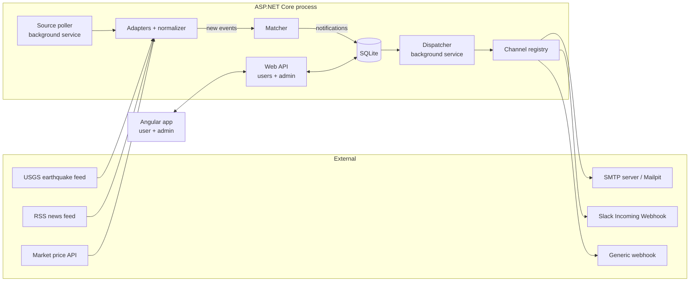
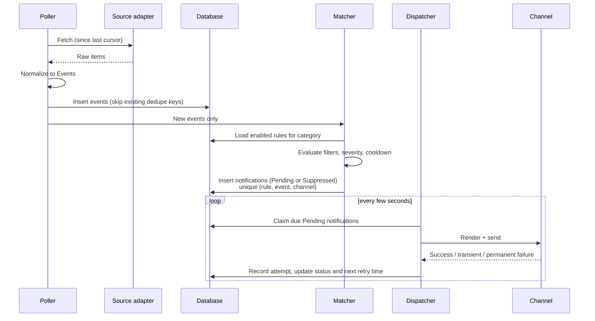
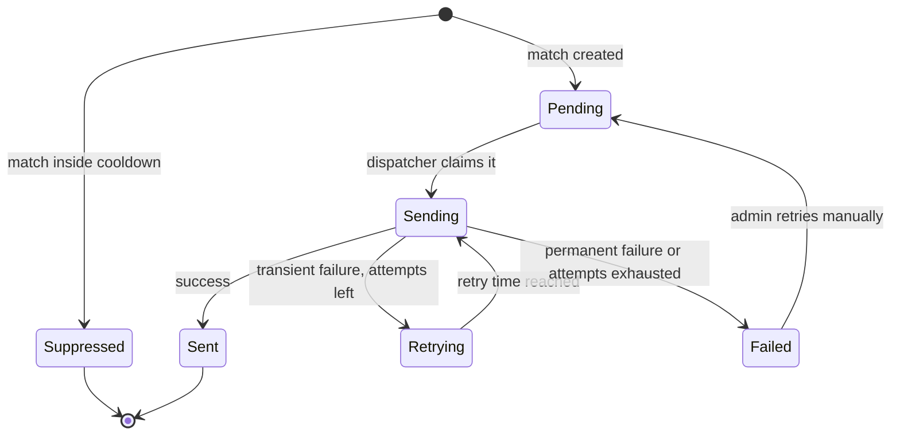
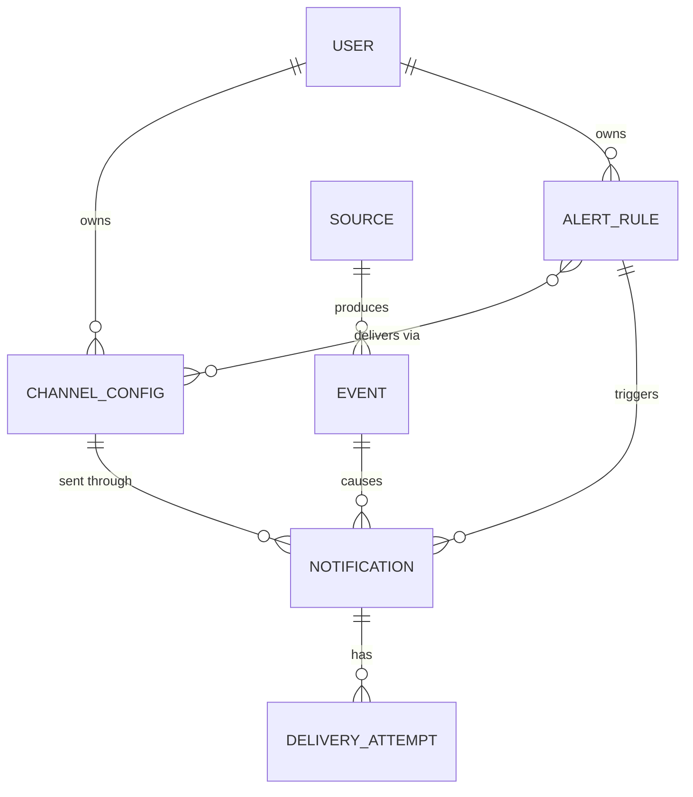

# Architecture and Design

This document describes how EventAlertManagement is structured: the pieces, how data flows through them, the data model, the API, and the main design choices. It builds on [PLAN.md](PLAN.md) and [ASSUMPTIONS.md](ASSUMPTIONS.md). Decisions with real trade-offs are recorded in [DECISIONS.md](../DECISIONS.md), and each section below points to the relevant ones.

Everything here is a design, not a description of finished code. Where a detail depends on a real service behaving as we expect, it is marked **to verify**.

---

## 1. System overview



Three things run inside one process:

1. **Poller**: on a schedule, asks each enabled source for new items.
2. **Matcher**: turns new events into notifications.
3. **Dispatcher**: delivers pending notifications through channels.

The Web API serves the Angular app and shares the same database. Splitting these into separate services is possible later but is deliberately not done now (ADR-006).

---

## 2. Code structure

```
src/
  EventAlertManagement.Core/            Domain model, rules, contracts. No framework or I/O dependencies.
  EventAlertManagement.Infrastructure/  EF Core, source adapters, channels, background services.
  EventAlertManagement.Api/             Controllers, authentication, configuration, hosting.
  EventAlertManagement.Web/             Angular application.
tests/
  EventAlertManagement.Tests/           Unit and integration tests.
fixtures/                               Real captured responses from external sources.
```

**Dependency direction:** `Api → Infrastructure → Core`. Core never references the other projects. This keeps matching and rule logic testable without a database or network.

**Contracts in Core:**

| Contract | Responsibility |
|---|---|
| `IEventSource` | Fetches new items from the outside and returns normalized events. |
| `INotificationChannel` | Declares its type, validates its own settings, renders a notification, sends it, and returns a clear result (success, transient failure, permanent failure). |
| `IChannelRegistry` | Finds the channel implementation for a type. |
| `IClock` | Current time. Injected so cooldown and retry logic can be tested without waiting. |
| `IEventMatcher` | Decides whether an event satisfies a rule. Pure logic, no I/O. |

**Authentication** sits behind an identity abstraction so the minimal sign-in can be replaced later (ADR-007).

---

## 3. How an event becomes a notification



Key properties:

- **Events and their notifications are created in one database transaction.** A crash cannot leave an event that was "seen" but never matched. (ADR-011)
- **Re-running the matcher is safe.** The unique constraint on (rule, event, channel) makes duplicates impossible. (ADR-008, ADR-009)
- **The poller advances its cursor only after the transaction commits.** A failed poll is retried from the previous position.
- **Sending is never part of the matching transaction.** Slow or failing channels cannot block ingestion.

### Notification states



`Suppressed` notifications are stored (not silently dropped) so an admin can answer "why did I not get an alert for this?".

---

## 4. Data model



All timestamps are UTC. All identifiers are GUIDs unless stated.

### User
| Field | Notes |
|---|---|
| Id, Email (unique), DisplayName | Email is the identity in the minimal sign-in. |
| Role | `User` or `Admin`. |
| CreatedAt | |

### ChannelConfig
One configured destination for one user, for example "my Slack channel" or "my work email".
| Field | Notes |
|---|---|
| Id, UserId | |
| Type | `Email`, `Slack`, later `Webhook`. Must match a registered channel. |
| Name | Human label. |
| SettingsProtected | The channel's settings (address, webhook URL, …) stored encrypted. Each channel type defines and validates its own shape. (ADR-014) |
| IsEnabled | User can pause it. |
| LastTestedAt, LastTestResult | Result of the "send test message" action. |

### AlertRule
| Field | Notes |
|---|---|
| Id, UserId, Name | |
| Category | `News`, `Markets`, `Disasters`. |
| MinSeverity | 1–5. |
| FiltersJson | Category-specific filters, validated against a typed model (see below). (ADR-010) |
| CooldownSeconds | Minimum time between notifications for this rule. 0 = none. |
| IsEnabled | |
| Channels | Many-to-many link to the user's ChannelConfigs. At least one required. |
| LastNotifiedAt | Used for cooldown. |

**Filters by category (typed):**

| Category | Filters |
|---|---|
| News | Include keywords (any), exclude keywords, optional source names. |
| Disasters | Minimum magnitude, optional region text or bounding box, optional event types. |
| Markets | One or more tickers, minimum percentage move, direction (up, down, either). |

### Source
| Field | Notes |
|---|---|
| Id, Key (unique), Name, Category | Key such as `usgs-earthquakes`, `simulator`. Category is empty for sources that produce several categories, such as the simulator. |
| IsEnabled, PollIntervalSeconds | Admin-controllable. |
| Cursor | Opaque position (for example "last seen time" or id). |
| LastPollAt, LastSuccessAt, LastError, ConsecutiveFailures | Source health, shown to admins. |

### Event
| Field | Notes |
|---|---|
| Id, SourceId | |
| DedupeKey | Source key + the source's own stable identifier. **Unique.** |
| Category, Severity (1–5) | |
| Title, Summary, Url | **Untrusted text.** Escaped at output time. |
| Location (text, optional lat/lon) | |
| Attributes (JSON) | Category-specific facts such as magnitude, ticker, percentage change. Filters read these. |
| OccurredAt, IngestedAt | |
| IsSimulated | True for simulator and admin-injected events, shown in the UI. |

### Notification
One intended message to one destination for one match.
| Field | Notes |
|---|---|
| Id, RuleId, EventId, ChannelConfigId | **Unique on (RuleId, EventId, ChannelConfigId).** |
| Status | Pending, Sending, Retrying, Sent, Failed, Suppressed. |
| SuppressedReason | For example "cooldown until …". |
| AttemptCount, NextAttemptAt | Drive retries. |
| LeaseUntil | Marks a notification as claimed by the dispatcher. |
| CreatedAt, SentAt | |

### DeliveryAttempt
| Field | Notes |
|---|---|
| Id, NotificationId, AttemptNumber, StartedAt, DurationMs | |
| Outcome | Success, TransientFailure, PermanentFailure. |
| ErrorMessage | Sanitized: secrets and webhook URLs removed. |

### Severity mapping (starting values, **to tune against real data**)

| Source | Rule |
|---|---|
| USGS earthquakes | Magnitude below 4.5 → 1; 4.5–5.4 → 2; 5.5–6.4 → 3; 6.5–7.4 → 4; 7.5 and above → 5. |
| Markets | Absolute 24h move below 3% → 1; 3–5% → 2; 5–8% → 3; 8–12% → 4; 12% and above → 5. |
| News | Fixed default of 2. No reliable severity exists (ASSUMPTIONS A7). |
| Simulator | Whatever the injector chooses. |

---

## 5. Sources

Each source implements `IEventSource`, which receives its stored cursor and returns events plus a new cursor. Adapters hold no database access. Failures are reported to the poller, which updates source health.

| Source | Detail |
|---|---|
| **Simulator** | Generates events on demand (API and admin UI) and optionally on a timer. Uses the same contract and the same pipeline. |
| **USGS earthquakes** | Reads a public GeoJSON summary feed. DedupeKey uses the feature id. **Verified** against the real feed: URL, field names and id uniqueness are as assumed. Events are ignored if older than a configurable age (default 3 hours) so the first poll does not alert on a whole day of old quakes. Revised magnitudes are not re-notified (known limitation). |
| **RSS news** | Reads one or more public RSS feeds. DedupeKey uses the item guid, falling back to the link. **To verify:** guid stability and publication date format. |
| **Markets** | Polls a small configured list of tickers. Emits an event only when the absolute move reaches a floor (starting value 1%). (ADR-012) **To verify:** endpoint, rate limits, error format. |

**Revised events.** If a source later reports a changed value for an item we already stored (for example a corrected earthquake magnitude), we keep the original event and do not notify again. This is a known limitation and is listed in the README.

---

## 6. Channels

```
INotificationChannel
  Type            -> "Email" | "Slack" | "Webhook"
  ValidateSettings(settings) -> list of problems
  MaskSettings(settings)     -> display-safe text with secrets hidden
  SendAsync(message, settings) -> Success | TransientFailure | PermanentFailure
```

Rendering is internal to each channel (it is not part of the contract), because the dispatcher never needs the rendered message. `MaskSettings` was added so the API can never return a secret by accident.

| Channel | Behavior |
|---|---|
| **Email** | SMTP via MailKit. Plain text and HTML body, both built from **escaped** event text. Settings: destination address. Server settings are global configuration, not per user. |
| **Slack** | HTTP POST of JSON to an Incoming Webhook. Text is escaped following Slack's rules for `&`, `<`, `>`. The webhook URL must be HTTPS and on Slack's webhook host. **To verify:** payload format and success response against Slack's documentation and a real test webhook. |
| **Webhook** (added late) | Generic JSON POST to a user-provided URL, with a signature header. Added without touching core code; the diff is the evidence. Needs the same SSRF protections as Slack, plus blocking of private address ranges. |

**Failure classification** (drives retries):
- *Transient*: network error, timeout, HTTP 429 or 5xx, SMTP temporary failure. Retried with backoff.
- *Permanent*: invalid or revoked webhook (HTTP 404/410), rejected address, validation failure. Marked `Failed` immediately.

**Retry policy** (configurable): up to 5 attempts with increasing delays (starting values: 1 minute, 5 minutes, 15 minutes, 1 hour), with a short delay profile available for demos and tests. (ADR-013)

---

## 7. API outline

JSON over HTTPS, described by an OpenAPI document. The Angular client is generated from it. Errors use the standard problem-details format.

### Authentication
| Method | Path | Purpose |
|---|---|---|
| POST | `/api/auth/login` | Sign in as a user by email; returns a signed token. Creates the user on first use. |
| POST | `/api/auth/admin-login` | Sign in as admin with a configured admin key; returns a token carrying the admin role. |

### User endpoints (require a user token; always scoped to the signed-in user)
| Method | Path | Purpose |
|---|---|---|
| GET | `/api/me` | Current user. |
| GET / POST | `/api/channels` | List and create channel configs. Settings are validated by the channel. Secrets are never returned in full. |
| PUT / DELETE | `/api/channels/{id}` | Update or remove. |
| POST | `/api/channels/{id}/test` | Send a test message; returns the real result. |
| GET / POST | `/api/rules` | List and create alert rules. |
| GET / PUT / DELETE | `/api/rules/{id}` | |
| GET | `/api/rules/presets` | Starter rules per category. |
| POST | `/api/rules/preview` | "Which recent events would this rule have matched?" Helps users tune rules and helps us test matching. |
| GET | `/api/notifications` | The user's own notification history and status. |

### Admin endpoints (require the admin role)
| Method | Path | Purpose |
|---|---|---|
| GET | `/api/admin/overview` | Counts and recent failures. |
| GET | `/api/admin/events` | Filterable, paged. |
| POST | `/api/admin/events/inject` | Create a simulated event. |
| GET | `/api/admin/notifications` | Filter by status, user, channel; includes attempts and sanitized errors. |
| POST | `/api/admin/notifications/{id}/retry` | Move a Failed notification back to Pending. |
| GET | `/api/admin/rules`, `/api/admin/users` | Read-only lists. |
| GET | `/api/admin/sources` | Source health. |
| PUT | `/api/admin/sources/{id}` | Enable, disable, change interval. |
| POST | `/api/admin/sources/{id}/poll` | Poll now. |
| GET / PUT | `/api/admin/channel-types` | List channel types and enable or disable each globally. |

---

## 8. Frontend structure

Angular with standalone components, a typed client generated from OpenAPI, and route guards for sign-in and admin role. Visual design is intentionally plain.

| Area | Screens |
|---|---|
| Sign-in | Email sign-in; admin sign-in. |
| Channels | List, add (form depends on channel type), send test message. |
| Rules | List, create and edit (category-specific filter form), start from a preset, preview of recent matches. |
| History | The user's notifications and their delivery status. |
| Admin | Overview, events (with inject), notifications (with attempts and retry), sources (health, poll now), rules and users (read-only), channel types. |

The admin notifications screen is built before the other admin screens, because it answers the most important operational question.

---

## 9. Cross-cutting concerns

| Concern | Approach |
|---|---|
| **Time** | UTC everywhere. All time-dependent code uses `IClock`. |
| **Secrets** | Channel settings encrypted with ASP.NET Core Data Protection. Masked in API responses, logs and UI. Errors are sanitized before storage. (ADR-014) |
| **Untrusted text** | Event text is escaped at the point of output for each format (HTML, Slack, JSON). Never stored pre-escaped. |
| **SSRF** | Outbound URLs from users are allow-listed by host and scheme; private ranges blocked for the generic webhook. |
| **Authorization** | Every user endpoint filters by the signed-in user's id. Tested with a second user attempting to read the first user's data. |
| **Observability** | Structured logs for poll results, matches, and delivery outcomes. Source health and delivery history are visible in the admin UI. |
| **Configuration** | Poll intervals, severity mappings, retry delays, SMTP and admin key come from configuration, with development defaults. |
| **SQLite limits** | One writer at a time. The dispatcher claims work with a single atomic update, and there is one dispatcher instance. Fine at this scale; documented. |

---

## 10. Testing approach

- **Unit tests (Core):** matcher (every filter type, boundaries), severity mapping, cooldown, retry scheduling, failure classification. Written from the specification, not from the code.
- **Adapter tests:** parse the **real captured fixtures**; also malformed and empty responses.
- **Channel tests:** rendering and escaping with hostile text; settings validation including URL allow-listing.
- **Integration tests:** real database (SQLite file or in-memory shared connection) running the pipeline: ingest the same event twice → one notification; broken channel → `Failed` and manual retry works; cooldown suppresses and records.
- **API tests:** anonymous and non-admin requests rejected; user A cannot read user B's data.
- **End-to-end check (manual, with evidence):** real email visible in Mailpit; real or clearly labelled fake Slack message.
- **Mutation check:** deliberately break the matcher or dedupe logic and confirm tests fail.

---

## 11. What is intentionally not designed

No separate microservices, queues, caching, user-managed API keys, rule sharing between users, digest scheduling, per-user time zones, or audit logging. These are listed as non-goals in [ASSUMPTIONS.md](ASSUMPTIONS.md).

---

## 12. Open design risks to resolve while building

| Risk | How we will find out |
|---|---|
| Real feeds do not match our assumed shape | Capture real responses before writing parsers. |
| Market API limits or terms prevent polling | Test early; fall back to simulator-only for markets and say so. |
| Revised earthquake events cause confusing behavior | Check real feed behavior; document the limitation if confirmed. |
| Typed filters in JSON become hard to evolve | Keep a version number inside the filter JSON; test loading older shapes. |
| Cooldown hides important events | Suppressed notifications are recorded and visible; reconsider if it causes confusion in the demo. |
| One dispatcher is a single point of failure | Accepted for this scope; lease timeouts recover work after a crash. |
