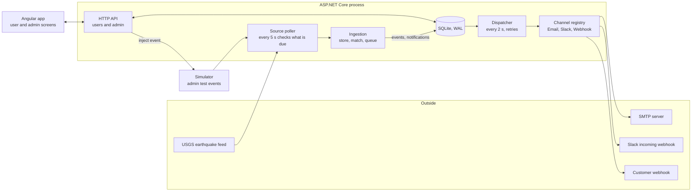
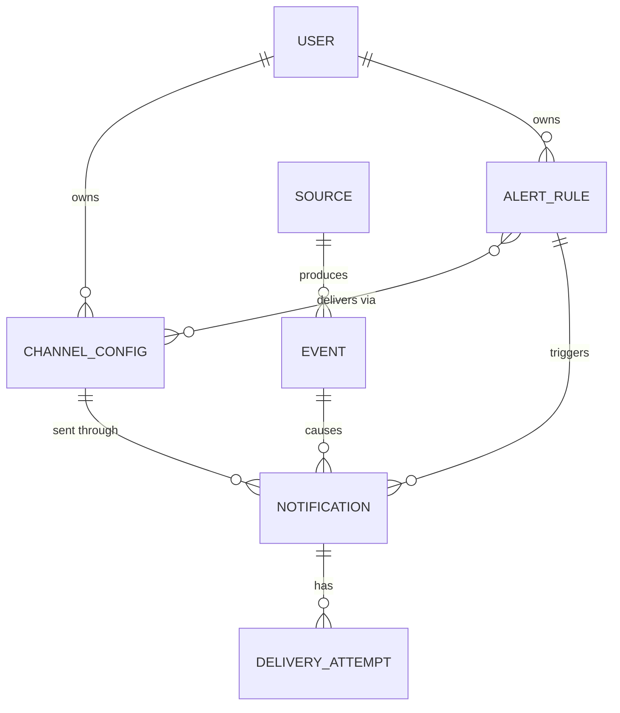
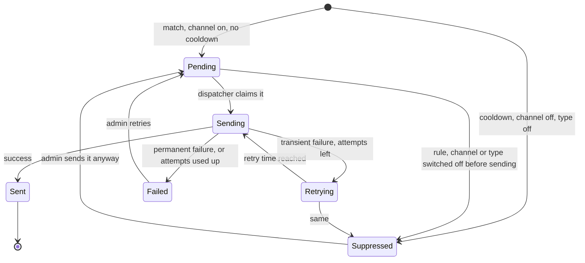
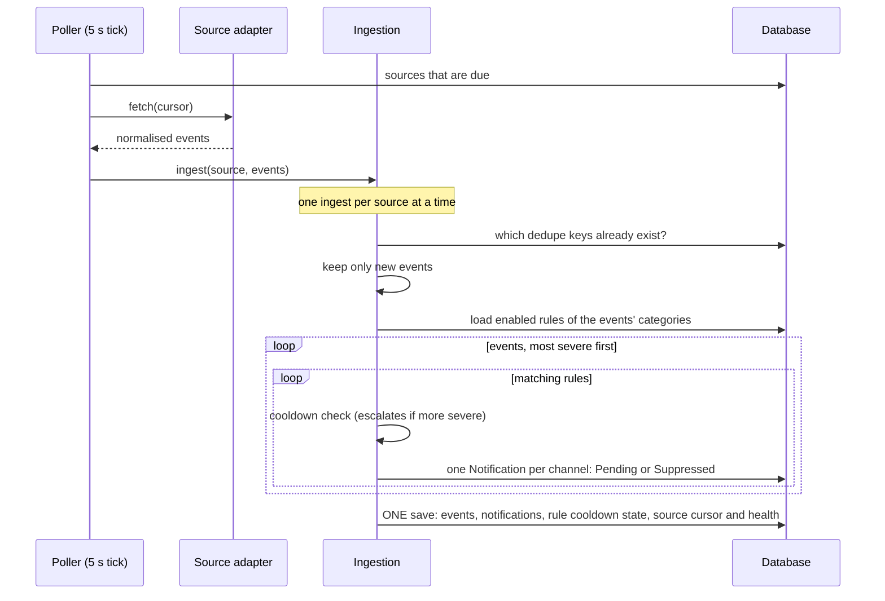
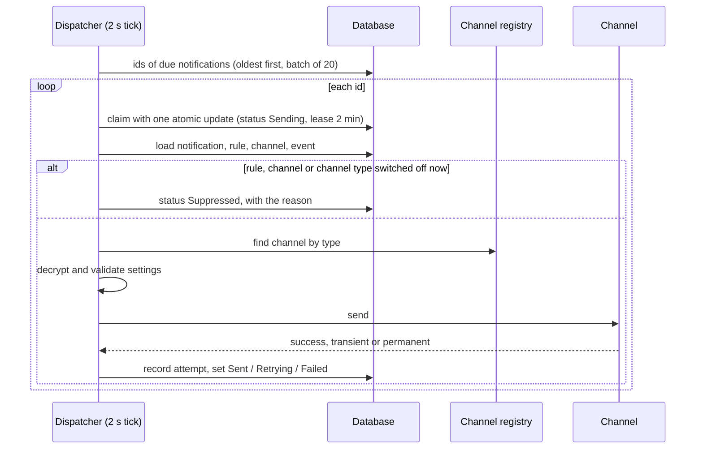

# EventAlertManagement – Design Document (as built)

| | |
|---|---|
| **Status** | Describes the system as it is in the repository, not as it was planned. |
| **Audience** | Someone who needs to understand, review, operate or extend the system. |
| **Companion documents** | [PLAN.md](PLAN.md) (the plan at the start), [ASSUMPTIONS.md](ASSUMPTIONS.md) (how the brief was interpreted), [ARCHITECTURE.md](ARCHITECTURE.md) (the design made before building, partly superseded by this page), [../DECISIONS.md](../DECISIONS.md) (21 decisions and the options not taken), [OUTCOME.md](OUTCOME.md) (plan against reality), [../REVIEW_LOG.md](../REVIEW_LOG.md) (what went wrong and how it was found). |

Where this page and an older document disagree, this page is right. Where a statement here has a limit or an open question, it says so.

---

## 1. The task

### 1.1 The brief

A product manager handed over this, and nothing more:

> "We want users to be able to set up alerts so they get notified when something important happens in the world — like breaking news, market movements, natural disasters, that kind of thing. Should work for both email and Slack. Make it flexible enough that we can add more channels later. We need an admin view too."

No wireframes, no schema, no agreement on what "important" means, where data comes from, or how events are detected. The work was also an exercise in directing AI agents: the process (plans, decisions, checks, rejected output) is part of what was delivered, which is why this repository carries the review log, prompt history and evidence next to the code.

### 1.2 What was ambiguous, and how it was settled

| Open question | Resolution | Where decided |
|---|---|---|
| What is "important"? | The system does not judge. Every event has a category and a severity from 1 to 5, and **each user's rule** decides what matters to them. | ADR-001 |
| Where does the data come from? | Pluggable **source adapters**. One real source (USGS earthquakes) and a **simulator** that administrators drive. | ADR-002, ADR-020 |
| How are events detected? | **Polling** on a schedule, de-duplicated. No streaming, no machine learning. | ADR-002 |
| What does "set up an alert" mean? | A **rule**: category, filters, minimum severity, cooldown, and the channels to notify. | ADR-010 |
| How do email and Slack work? | Email over SMTP; Slack through a per-user incoming webhook. | ADR-005 |
| "Add more channels later" | A **channel contract** and registry. Proven by adding a third channel (a signed webhook) with one added line outside its own files. | ADR-004, [evidence](../evidence/007-third-channel.md) |
| What is the admin view for? | Operating the pipeline and answering "why did this alert not arrive?" | §8, §9 |
| Sign-in | Deliberately minimal (email for users, a shared key for admin). | ADR-007, ADR-016 |

### 1.3 Goals and non-goals

**Goals**
- A user can create rules, attach channels, see what happened to every alert, and trust that an alert is sent once.
- An administrator can see events, every delivery with each attempt, source health, who has which rules, retry or send an alert on request, create test events, and switch a channel type off for everyone.
- A new delivery channel or source is one class and one registration.
- Failures are visible, recoverable and never silent.

**Non-goals** (stated so they are not mistaken for omissions)
- Production-grade identity (passwords, verification, single sign-on), email verification of channel addresses.
- Machine-learning scoring of importance, digests, quiet hours, streaming ingestion.
- Horizontal scaling, message brokers, high availability, localisation, a visual design system.
- Live news and market feeds (see §7.3). Those two categories work end to end with test events only.

### 1.4 Who uses it

| Person | Does |
|---|---|
| **User** (any signed-in email address) | Adds channels (email, Slack, webhook), tests them, builds rules from examples, previews what a rule would have matched, reads the history of their alerts. |
| **Administrator** (holds the admin key) | Watches deliveries and retries, creates test events, checks source health and polls on demand, reads all users and rules, turns a channel type off or on. |
| **Receiver of a webhook** (someone's server) | Verifies the signature of each message and ignores old ones (§6.4). |

---

## 2. Solution overview

One ASP.NET Core process hosts the HTTP API and two background workers. They share a SQLite database. An Angular single-page application is the interface. Everything that happens to an alert is a row in the database, so progress survives restarts and can be shown.



**The central idea is the outbox.** Matching an event against rules creates `Notification` rows in the same save as the event. Sending is a separate step that reads those rows. A slow or failing destination therefore never blocks ingestion, a crash cannot lose a queued alert, and every attempt can be shown to an administrator.

---

## 3. Architecture

### 3.1 Code structure

```
src/
  EventAlertManagement.Core/            Domain, rules, contracts. No I/O, no framework.
  EventAlertManagement.Infrastructure/  EF Core, sources, channels, workers, security helpers.
  EventAlertManagement.Api/             Controllers, authentication, hosting, OpenAPI.
  EventAlertManagement.Web/             Angular application.
tests/EventAlertManagement.Tests/       Unit, integration, API and channel tests.
e2e/journey.cjs                         Real-browser journey against the real stack.
tools/                                  smtp-sink.py, export-openapi.sh, verify.sh.
docs/ evidence/ prompts/                Design, proof, process.
```

Dependencies point inward: `Api → Infrastructure → Core`. Core knows nothing about databases, HTTP or SMTP, so matching, cooldown, severity and retry logic are tested without any of them.

### 3.2 Technology

| Layer | Choice |
|---|---|
| Backend | .NET 8, ASP.NET Core controllers, hosted background services |
| Persistence | EF Core on SQLite (write-ahead logging on); the schema is created, not migrated |
| Email | MailKit |
| Authentication | Signed JWT (HMAC-SHA256), roles `User` and `Admin` |
| Secrets at rest | ASP.NET Core Data Protection for channel settings |
| API description | Swashbuckle OpenAPI, exported to `docs/openapi.json` |
| Frontend | Angular 22.2.7 (pinned), standalone components, signals, zoneless change detection, TypeScript 6 |
| Frontend tests | Vitest through `ng test` |
| Backend tests | xUnit, `WebApplicationFactory` |
| CI | GitHub Actions: backend, frontend, and a contract-drift job |

### 3.3 Contracts in Core (the extension points)

| Contract | Responsibility |
|---|---|
| `IEventSource` | Fetch new items, return normalised events and a new cursor. Never touches the database. |
| `INotificationChannel` | `Type`, `ValidateSettings`, `MaskSettings`, `SendAsync` returning success, transient failure or permanent failure. |
| `IChannelRegistry` | Finds a channel by type, ignoring letter case. |
| `IEventMatcher` | Decides whether an event satisfies a rule. Pure logic. |
| `ISettingsProtector` | Encrypts and decrypts channel settings. |
| `IClock` | Time, injectable so cooldown and retry are tested without waiting. |

---

## 4. Data model

All times are UTC. Identifiers are GUIDs. The database is created from the model on first start (`EnsureCreated`), so an existing local file must be deleted after a model change.



| Entity | Purpose and key fields | Invariants |
|---|---|---|
| **User** | Email (the identity), role | Email unique |
| **ChannelConfig** | One destination of one user: `Type`, `Name`, `SettingsProtected` (encrypted JSON), `IsEnabled`, last test time and result | Settings never leave the server unmasked |
| **AlertRule** | Category, `MinSeverity`, `FiltersJson` (typed per category, versioned), `CooldownSeconds`, `LastNotifiedAt`, `LastNotifiedSeverity`, channels | Filters must parse strictly for the category; at most 5 channels |
| **Source** | `Key`, enabled, poll interval, `Cursor`, `LastPollAt`, `LastSuccessAt`, `LastError`, `ConsecutiveFailures` | Key unique |
| **Event** | Source, `DedupeKey`, category, severity 1–5, title, summary, link, location, `AttributesJson` (magnitude, ticker, change, type), `OccurredAt`, `IsSimulated` | **`DedupeKey` unique**; text is untrusted and stored as received |
| **Notification** | One intended message to one destination for one match: status, suppressed reason, attempt count, next attempt, lease | **Unique on (rule, event, channel)** |
| **DeliveryAttempt** | Attempt number, start, duration, outcome, sanitised error | Numbers keep counting across manual retries |
| **ChannelTypeSetting** | Admin switch per channel type | Absent row means enabled |

### 4.1 Notification states



`Suppressed` means *someone's choice stopped it*, `Failed` means *delivery was tried and did not work*. The distinction is shown to users and admins.

### 4.2 Rule filters

Stored as JSON, parsed strictly (unknown members are an error, never ignored), one shape per category:

| Category | Filters |
|---|---|
| News | include keywords (any), exclude keywords, source keys |
| Disasters | minimum magnitude, region text, event types |
| Markets | tickers, minimum percentage move, direction (up, down, either) |

Keywords and region match **anywhere in the text**, so "war" also matches "software".

---

## 5. Behaviour

### 5.1 From event to queued alert



- **De-duplication.** Key is `source:externalId`; the database index is the last line of defence.
- **Cooldown with escalation.** A rule may not alert again for `CooldownSeconds`, *except* that an event more severe than the one that started the window always gets through. Within one batch the most severe event is processed first, so the one that gets the slot is the one that matters most (ADR-021).
- **Suppressed is recorded**, not dropped: disabled channel, channel type switched off, or cooldown, each with its reason.
- **Atomic.** Events, notifications, cooldown state and the source's cursor are saved together. A failed poll leaves no half-built state; the cursor never moves ahead of stored events.
- **Isolation.** Each source is polled as its own unit of work; one failing source does not affect the others.

### 5.2 Delivery



- **Claiming** is atomic and uses a lease, so an alert is never taken twice, and a crashed dispatcher's work is picked up when the lease expires.
- **Retry policy.** Up to 5 attempts, delays 1 min, 5 min, 15 min, 1 h. Only *transient* failures (network, timeout, 408, 429, 5xx, SMTP 4xx) are retried. *Permanent* failures (rejected address, revoked webhook, blocked destination, invalid settings) fail at once.
- **One broken alert never stops the batch**: if an alert disappears mid-send (its rule was deleted), the rest are still delivered.
- **Delivery is at-least-once.** A crash between sending and saving can produce one duplicate (ADR-003).
- **Manual retry.** An administrator can retry a `Failed` alert and send a `Suppressed` one anyway. Attempt numbers continue.
- Stored errors pass through a sanitiser that removes URLs and limits length; channels return fixed wording, never exception text.

### 5.3 Other flows

| Flow | Behaviour |
|---|---|
| **Sign-in** | `POST /api/auth/login` with an email creates the user on first use and returns a token (8 h). `POST /api/auth/admin-login` with the admin key returns an admin token. Both are rate limited per caller address. |
| **Test a channel** | Sends one real message through the channel and stores the result. Allowed once per 10 s per channel (claimed with one atomic update) and 6 per minute per user. |
| **Create a test event** | Admin-only. Goes through the same ingestion path as real events and is marked simulated. |
| **Rule preview** | Runs an unsaved rule against stored events of the last 7 days and returns counts and samples. Nothing is saved or sent. |
| **Source health** | Healthy, Degraded (1–2 failures in a row), Failing (3 or more), Disabled, NeverPolled. An admin can poll on demand and change the interval. |
| **Switch a channel type off** | New matches are suppressed; alerts already queued are suppressed at send time. |

---

## 6. Channels

### 6.1 The contract

A channel validates its own settings, masks them for display, and sends, returning a result that says whether a retry could help. It never sees the database. The registry finds channels by type; **adding one is a class plus one registration line**.

### 6.2 Email

SMTP through MailKit. Settings: one address, validated strictly (no line breaks, no lists, no display names). The HTML part is built from encoded event text; the plain part keeps text as is; the subject is one line. Links are rendered only if they are http or https and carry no user name or password.

### 6.3 Slack

POST of `{"text": …}` to an incoming webhook. The URL must be `https://hooks.slack.com/services/…` on the default port without credentials; redirects are never followed. Text escapes `&`, `<`, `>` as Slack requires. Status mapping, confirmed against Slack's documentation: 200 success; 429 and 5xx transient; 400, 403, 404, 410 permanent.

### 6.4 Webhook (the extensibility proof)

A signed JSON POST to a user-supplied https URL. Because **the user controls the entire destination**, it has the strongest protection of the three.

**Message.** Body: `id, title, summary, url, location, category, severity, occurredAt, isSimulated, rule, source`. Headers: `X-EventAlert-Timestamp` (Unix seconds), `X-EventAlert-Signature: sha256=<hex>`, `X-EventAlert-Event` (event id).

**Receiver verification.** Compute `HMAC_SHA256(secret, timestamp + "." + body)` as lower-case hex, compare with the header in constant time, and reject timestamps that are too old. The secret is chosen by the user (at least 16 characters).

**Address protection, in layers (ADR-019).**
1. *When saved:* https only; no credentials in the URL; no internal-looking names (`localhost`, single-label names, `.local`, `.internal`, …); odd spellings of addresses (decimal, hex, octal, short forms, trailing dots, full-width digits, IPv4 inside IPv6) are folded to plain form and checked; names ending in a number are refused.
2. *When connecting (decisive):* the name is resolved, **every** resulting address must be public, and the connection goes to the address that was checked. A name that looked public when saved but resolves to an internal address later (DNS rebinding) is therefore refused. IPv4 uses a block list of internal and reserved ranges; IPv6 allows only global unicast minus its reserved blocks.
3. Redirects are never followed; connections live at most 2 minutes so addresses are checked again; no proxy by default (a proxy would make the connection itself and hide the real destination).
4. A blocked address is a *permanent* failure: no retries against an internal target.

Request logging is removed for the webhook and Slack clients, because their addresses are secrets.

### 6.5 Adding a channel

1. Implement `INotificationChannel` (validation, masking, send with honest failure classes).
2. Register it. The API lists it for users and admins automatically; the admin switch and masking apply; the Angular screen falls back to a raw JSON settings box and can be given a proper form later (the webhook worked first, then got one).
3. Tests: validation table, rendering with hostile text, failure classification, one pipeline test.

---

## 7. Sources

### 7.1 Contract

`FetchAsync(cursor)` returns normalised events (external id, category, severity, title, summary, link, location, attributes, time) and a cursor. Adapters hold no database access. A malformed item is skipped; a document of an unexpected shape is an **error** (a changed format must show as a failed poll in source health, not as silence).

### 7.2 Simulator

Holds events that an administrator creates. It uses the same contract and the same pipeline as real sources, and its events are flagged `IsSimulated` and shown as such. It exists so every category can be demonstrated and tested.

### 7.3 USGS earthquakes (the only live source)

Reads the public GeoJSON feed (default: magnitude 2.5+, past day; polled every 5 minutes). Verified against a real captured response (`fixtures/usgs/`) and the live service.

| Mapping | |
|---|---|
| Severity from magnitude | below 4.5 → 1; 4.5–5.4 → 2; 5.5–6.4 → 3; 6.5–7.4 → 4; 7.5 and up → 5 |
| De-duplication key | USGS event id |
| Age limit | Events older than 3 hours are ignored, so the first poll does not alert on a whole day of old quakes |

**Limits:** a revised magnitude is not re-notified (the first version is kept); an event that first appears in the feed more than 3 hours after it happened is dropped; an outage over 3 hours loses events.

**News and markets** have a designed but unbuilt source (ADR-012 describes market price bands). They are handled by rules, matching, delivery and the admin area, and react only to test events (ADR-020). The severity table for percentage moves (3, 5, 8 and 12 per cent) exists in code and is used by tests only.

---

## 8. HTTP API

JSON over HTTP, described by `docs/openapi.json` (24 paths, 30 operations). Enumerations travel as strings. Errors use problem details. Lists are paged (page size at most 100).

### 8.1 Conventions

- **Everything requires a signed-in caller unless marked otherwise** (a fallback policy; only the two sign-in endpoints are open).
- **A resource that belongs to someone else is reported as 404**, exactly like a missing one, and ownership is part of every query (ADR-015).
- Request bodies over 256 KB are refused with 413 before they are read.
- Unexpected errors return a generic body; details go to the server log only.

### 8.2 Endpoints

| Area | Endpoints |
|---|---|
| Sign-in (open) | `POST /api/auth/login`, `POST /api/auth/admin-login` |
| Me | `GET /api/me` |
| Channels (user) | `GET/POST /api/channels`, `GET/PUT/DELETE /api/channels/{id}`, `POST /api/channels/{id}/test`, `GET /api/channels/types` |
| Rules (user) | `GET/POST /api/rules`, `GET/PUT/DELETE /api/rules/{id}`, `GET /api/rules/presets`, `POST /api/rules/preview` |
| History (user) | `GET /api/notifications` |
| Admin | `GET /api/admin/overview`, `GET /api/admin/events`, `POST /api/admin/events/inject`, `GET /api/admin/notifications`, `POST /api/admin/notifications/{id}/retry`, `GET /api/admin/rules`, `GET /api/admin/users`, `GET /api/admin/sources`, `PUT /api/admin/sources/{id}`, `POST /api/admin/sources/{id}/poll`, `GET /api/admin/channel-types`, `PUT /api/admin/channel-types/{type}` |

User endpoints accept only the `User` role and admin endpoints only `Admin`; an admin token cannot use user endpoints and the reverse.

---

## 9. Frontend

Angular 22 single-page application, standalone components, lazily loaded routes, signals for anything that arrives asynchronously, no UI library. It talks only to the API (during development `/api` is proxied).

### 9.1 Screens

| Area | Screens |
|---|---|
| Open | User sign-in, administrator sign-in |
| User | Rules (with last alert and a warning when no channel can reach anyone), rule editor (examples, per-category filters, preview), Channels (add with a per-type form, pause, test, delete), History (filter, paging, why an alert was suppressed or failed) |
| Admin | Overview, Deliveries (every attempt, retry or send anyway, auto-refresh), Events (create test events, filters), Users, Rules, Sources (health, check now, interval, on/off), Channel types (on/off for everyone) |

### 9.2 Structure and rules

| Piece | Role |
|---|---|
| `core/api-schema.ts` | Generated from the OpenAPI document and never edited; a changed API becomes a compile error. A CI job fails if it is stale. |
| `core/api.service.ts` | Every call to the API, in one place. |
| `core/auth.service.ts`, `auth.interceptor.ts`, `guards.ts` | Session in `sessionStorage`; token added only to `/api/*` calls and never to sign-in calls; a rejected token ends the session with an explanation on the sign-in page; guards steer users and admins to their own pages. |
| `core/rule-form.ts` | Turns the rule form into a request and back; sends only the filters of the chosen category. Pure and unit tested. |
| `shared/paged-loader.ts` | Lists: only the newest request counts, the refresh timer reloads the page the user asked for, a vanished page steps back. |
| `core/errors.ts` | Turns any failure into readable sentences; never shows raw server text. |

Screens are honest about the unbuilt parts: the rule editor says that news and markets react only to test events.

---

## 10. Cross-cutting design

### 10.1 Security

| Threat | Control |
|---|---|
| Server made to contact internal addresses (SSRF) | Webhook address layers (§6.4); Slack host fixed; redirects off |
| Reading or changing another user's data | Ownership inside every query; 404 for foreign resources; route-by-route test of guards |
| Privilege confusion | Roles checked per controller; fallback policy closed by default |
| Token forgery | Issuer, audience, lifetime and algorithm validated; the app refuses to start without a 32+ character signing key; admin key of 12+ characters or empty (which turns admin sign-in off) |
| Guessing the admin key | Constant-time comparison; sign-in rate limited per caller address |
| Secrets in storage | Channel settings encrypted (Data Protection); shown only masked (host only for webhook and Slack, first letter for email) |
| Secrets in logs and errors | Request logging off for secret-bearing clients; errors sanitised and fixed-wording; generic 500 bodies |
| Untrusted text from sources | Encoded per output (HTML, Slack, JSON); only http(s) links without credentials rendered; Angular escapes all bound text |
| Abuse of channel tests (mail to third parties) | One test per channel per 10 s (atomic), 6 per minute per user, 20 channels per user |
| Resource exhaustion | 50 rules per user, 5 channels per rule, filter lists and lengths capped, 256 KB bodies, paging capped |

**Known weaknesses:** email addresses are not verified (R-019); anyone who knows an email can sign in as that user (ADR-007); the rate limit keys on the caller address, which behind a reverse proxy is the proxy; user creation is bounded only by that limit; the Data Protection keys are stored unencrypted next to the database (ADR-014); the Development profile carries placeholder secrets; the session token sits in browser session storage.

### 10.2 Reliability

At-least-once delivery with leases and retries; every state change is a row; per-source ingest lock; atomic claim; a deleted rule or channel mid-send cannot stop the batch. Not designed for several instances (the claim is atomic but the save after a send does not check lease ownership, and the ingest lock is in-process).

### 10.3 Time

UTC everywhere, `IClock` everywhere. Cooldown is tested across both daylight-saving changes. Dates in the interface use the browser's locale without showing the zone.

### 10.4 Configuration

| Key | Default | Meaning |
|---|---|---|
| `ConnectionStrings:Default` | `Data Source=eventalert.db` | SQLite file |
| `DataProtection:KeysPath` | `keys` | Where encryption keys live (must persist) |
| `Auth:SigningKey` | *(none)* | Required, 32+ characters |
| `Auth:AdminKey` | *(none)* | 12+ characters, or empty to switch admin sign-in off |
| `Auth:TokenHours`, `Auth:LoginAttemptsPerMinute` | 8, 10 | Token life, sign-in attempts per minute per caller address |
| `Smtp:*` | `localhost:1025` | Mail server and sender |
| `Retry:MaxAttempts`, `Retry:Delays`, `Retry:Lease` | 5, 1/5/15/60 min, 2 min | Delivery retries |
| `Sources:Usgs:MaxEventAge`, `FeedUrl` | 3 h, 2.5+ day feed | USGS behaviour |
| `Webhook:UseSystemProxy`, `Webhook:TimeoutSeconds` | false, 10 | Webhook transport (a proxy removes the address guard) |
| `Workers:Enabled` | true | Turn background workers off (tests) |
| `Cors:Origins` | `http://localhost:4200` | Allowed browser origins |

### 10.5 Limits

| What | Limit |
|---|---|
| Rules per user / channels per user / channels per rule | 50 / 20 / 5 |
| Keywords per list / tickers, event types, sources / length of an item | 50 / 20 / 100 characters |
| Filters JSON | 16,000 characters |
| Cooldown | up to 30 days |
| Channel settings | 4,000 characters |
| Request body | 256 KB |
| Page size | 100 |

### 10.6 Observability

Structured logs of every ingest (new, duplicate, queued, suppressed), poll failures, unexpected delivery errors. In the interface: source health, every delivery with each attempt, and the reason for every suppressed alert. One unexplained connection error line can appear in the log at startup (R-026).

---

## 11. How it was verified

The design is only as good as the evidence for it. Verification was layered, and each layer was itself tested.

| Layer | What | Where |
|---|---|---|
| Unit | Matcher, cooldown and escalation, severity, retry, validation, address policy, signing, parsing | `tests/.../Unit`, `Channels` |
| Integration (real SQLite file) | De-duplication, atomic claim with parallel dispatchers, retries, leases, races, source failures, the unchanged pipeline delivering through the third channel | `tests/.../Integration` |
| API (`WebApplicationFactory`) | A sweep over every route (anonymous, wrong role), ownership isolation, validation, limits, secrets never returned | `tests/.../Api` |
| Real sockets | The address guard connects (or refuses) for real | `Channels/WebhookChannelTests.cs` |
| Real services (opt-in) | A real SMTP server; the live USGS feed | `EAM_SMTP_TEST_PORT`, `EAM_LIVE_TESTS` |
| Frontend | Pure logic, interceptor, guards, a route sweep, components with controlled response order | `src/EventAlertManagement.Web/src/**/*.spec.ts` |
| Real browser | A journey through the real stack: guards, channels, presets, previews, events, deliveries, retries, suppression, new admin screens, session end, phone width | `e2e/journey.cjs` |
| Mutation checks | About 100 deliberate bugs and reverted fixes, one at a time; every one but three harmless duplicates was caught | `evidence/` |
| Independent review | Three fresh reviewers on stripped copies: 40 findings, each reproduced before fixing | `evidence/independent-review/` |
| CI | Backend, frontend, and contract-drift jobs on every push | `.github/workflows/ci.yml` |

`bash tools/verify.sh` runs the backend, the frontend, the production build and the contract check locally. Current numbers: 418 backend tests (5 more need real services), 94 frontend tests.

---

## 12. Decisions at a glance

| | Decision | |
|---|---|---|
| ADR-001 | "Important" is each user's rule over scored events | |
| ADR-002 | Polling through source adapters | |
| ADR-003 | Outbox with a background dispatcher | amended: current-state check, deletion limit |
| ADR-004 | Channel contract and registry | proven by ADR-019's channel |
| ADR-005 | Slack through per-user incoming webhooks | |
| ADR-006 | ASP.NET Core, EF Core on SQLite, Angular | |
| ADR-007 | Minimal authentication | hardened by ADR-016 |
| ADR-008 | De-duplication and cooldown | refined by ADR-009, ADR-021 |
| ADR-009 | One notification per rule, event and channel | |
| ADR-010 | Rule filters as typed, versioned JSON | |
| ADR-011 | Matching inside the ingestion transaction | |
| ADR-012 | Market price bands | designed, not built |
| ADR-013 | Single dispatcher with leases and failure classes | amended: not for several instances |
| ADR-014 | Channel settings encrypted with Data Protection | amended: keys unencrypted on disk |
| ADR-015 | Foreign resources look like missing ones; closed by default | |
| ADR-016 | Sign-in hardening that fits a minimal scheme | |
| ADR-017 | Angular 22, pinned a week behind the newest release | |
| ADR-018 | Frontend structure and session handling | |
| ADR-019 | Webhook channel and address protection | amended after review |
| ADR-020 | Live news and market feeds not built | |
| ADR-021 | A cooldown must not hide the event that matters most | |

---

## 13. Known limits and deferred work

Everything below is also in the README and [OUTCOME.md](OUTCOME.md); it is repeated so this page stands alone.

**Product**
- Only natural disasters have live data; news and markets need test events (ADR-020).
- No retention: events, alerts and attempts grow without bound.
- Deleting a rule deletes the history of its alerts.
- Channels cannot be edited, only paused, tested or deleted; the owner of a failed alert cannot retry it (admins can).
- Keywords match anywhere in the text.

**Reliability**
- One serial dispatcher: a stalling destination delays everyone behind it (fan-out per rule is capped).
- Not ready for several instances.
- USGS: revisions and late items (§7.3).

**Security**
- Email addresses unverified; minimal sign-in; keys unencrypted on disk; sign-in limit by caller address; Slack formatting characters in event text are interpreted by Slack.

**Verified only in part**
- Slack: against its documentation and a stub, never a live webhook.
- The webhook channel: never sent over real TLS to a public server.
- Email: a real SMTP server was used, not Mailpit.
- Accessibility: basics only, no audit.

---

## 14. Glossary

| Term | Meaning |
|---|---|
| **Event** | A normalised fact from a source: category, severity, text, time. |
| **Rule** | A user's definition of what matters and where to send it. |
| **Notification** | One intended message to one destination for one rule and event. Stored before it is sent. |
| **Outbox** | Storing the intention to send before sending, so nothing is lost and everything is visible. |
| **Cooldown** | Minimum time between alerts for a rule; a more severe event gets through it. |
| **Suppressed** | An alert stopped by a choice (cooldown, paused channel, switched-off type or rule). |
| **Lease** | A time-limited claim on an alert by the dispatcher. |
| **SSRF** | Making the server contact an internal address on an attacker's behalf. |
| **Mutation check** | Breaking one line of code on purpose to see whether a test fails. |
